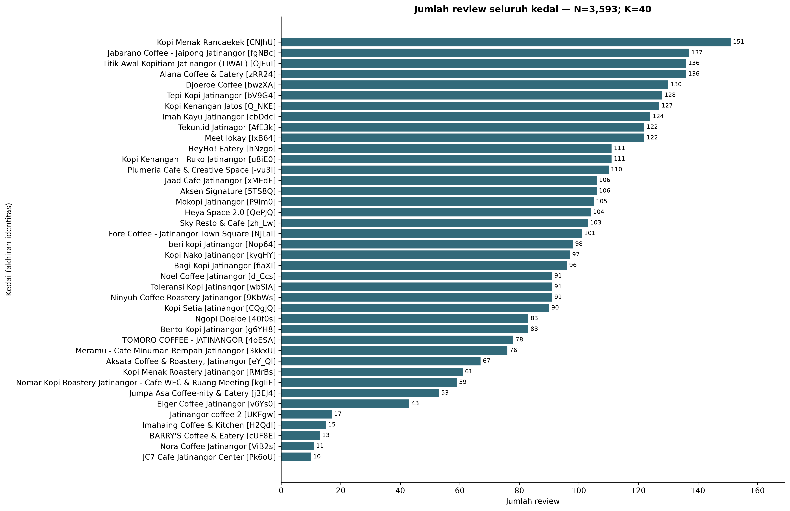
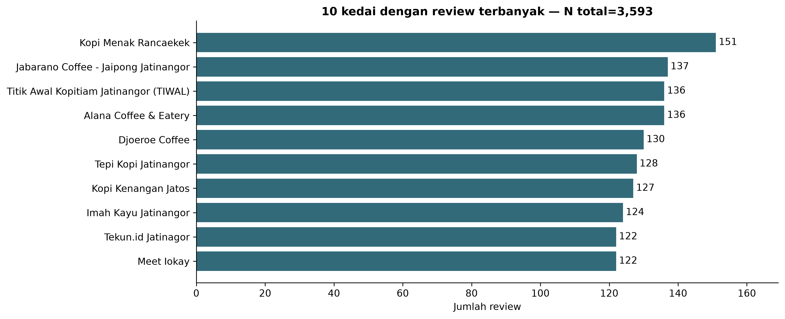
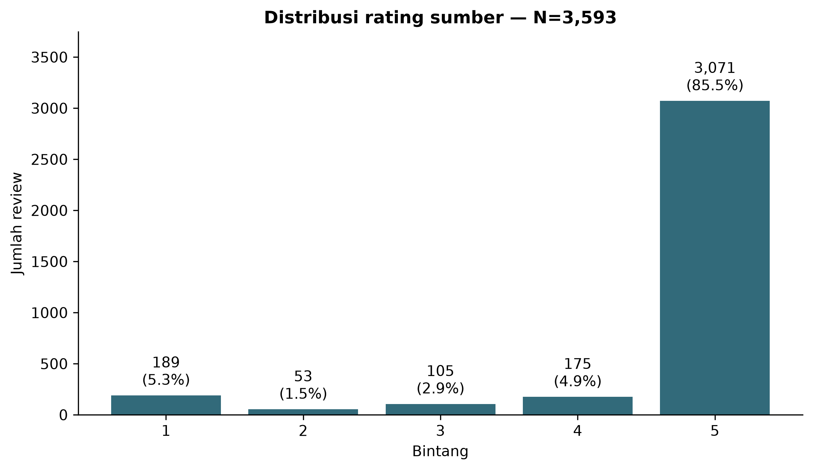
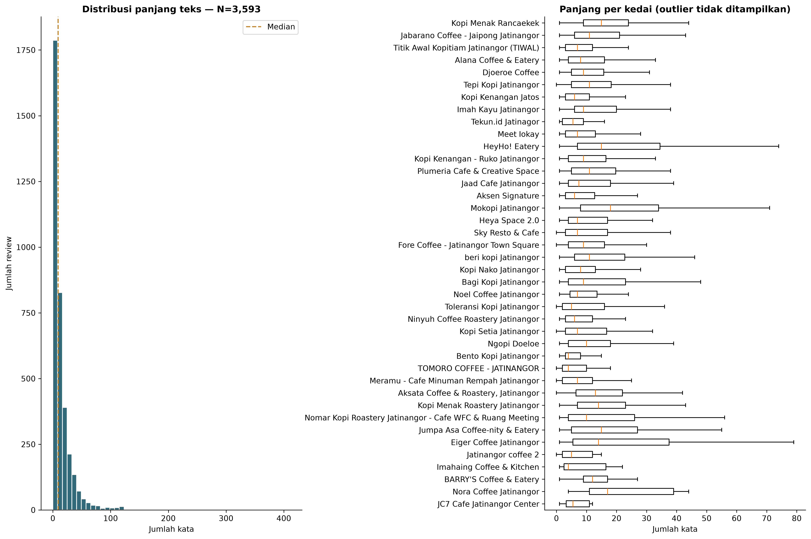
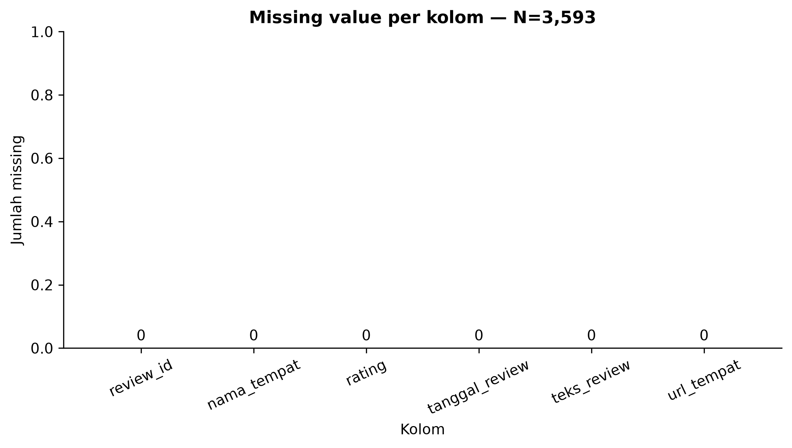
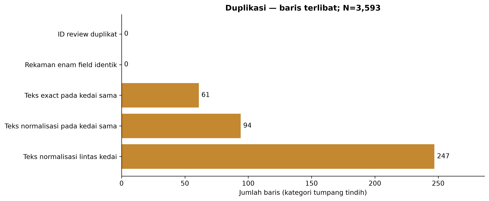
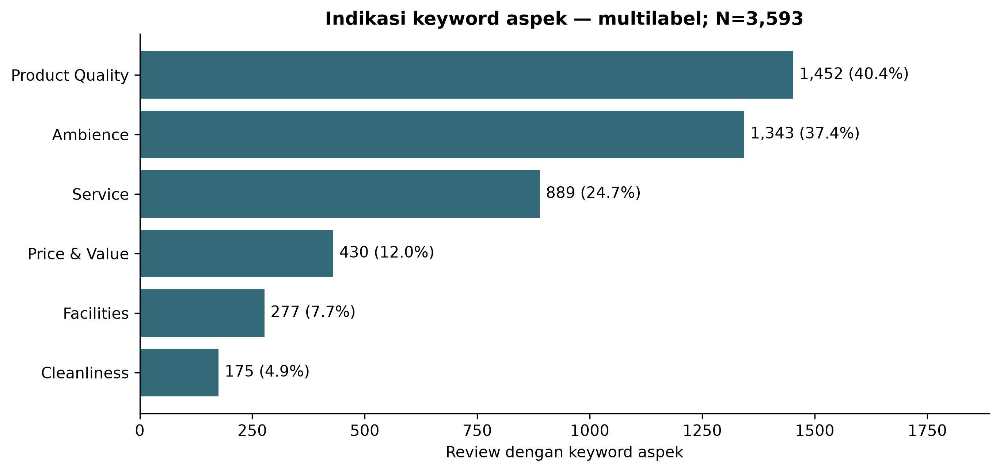
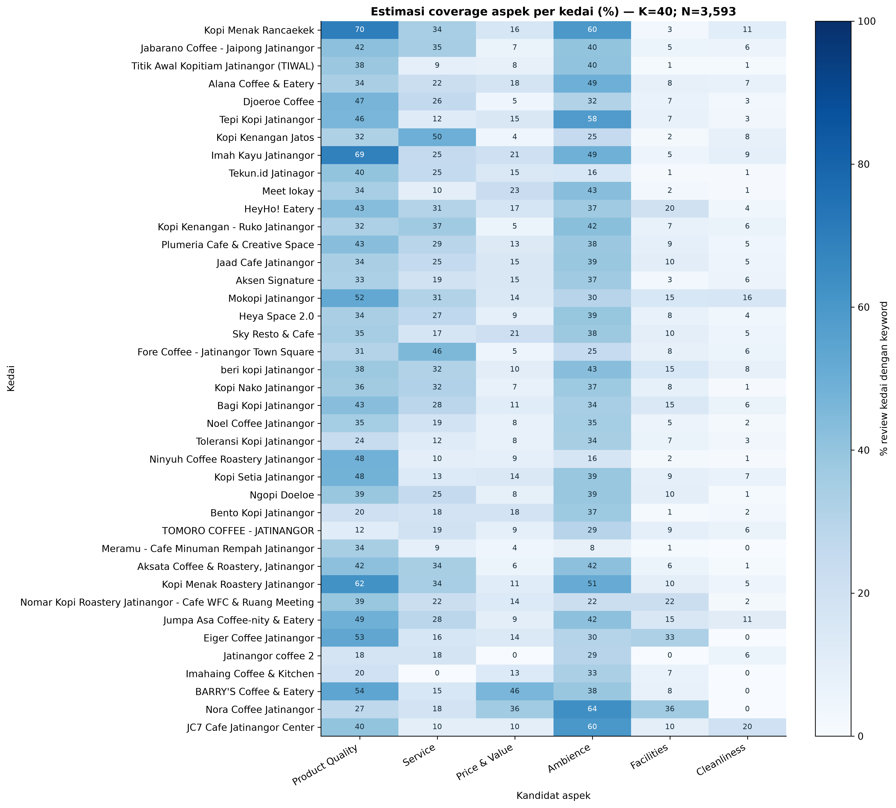

# Laporan Tahap 2 — Data Audit, Data Understanding & EDA

## 1. Pendahuluan dan tujuan audit

Audit ulasan Google Maps melalui Apify untuk menyiapkan penelitian ABSA Jatinangor. Entry point: notebooks/01_data_audit_eda.ipynb. Tanggal acuan: 2026-10-25T23:59:59+07:00. Tidak dilakukan API, scraping, labeling, atau training.

## 2. Deskripsi dataset

Data berisi 3,593 review, 40 identitas kedai, 40 nama, 3,593 ID unik, dan 40 URL unik. Memori sumber 2.70 MiB. Rentang tanggal 2016-09-13 14:39:50.043000+00:00 hingga 2026-10-25 05:07:03.416000+00:00. Rentang historis panjang tidak membuktikan sampling merata sepanjang waktu. Identitas URL membantu membedakan cabang dengan nama sama.

| column | dtype | unique_values |
| --- | --- | --- |
| review_id | string | 3593 |
| nama_tempat | string | 40 |
| rating | string | 5 |
| tanggal_review | string | 3593 |
| teks_review | string | 3439 |
| url_tempat | string | 40 |

SHA-256 sumber: 7b87a53110041da74e976a6c9cb121c1dea7d73be70daeab58b2c07bef775719.

## 3. Temuan kualitas data

Missing pada enam kolom: 0 sel. Rating invalid 0, tanggal invalid 0, tanggal setelah acuan 0, URL invalid 0. Teks simbol saja 11; pola relevansi rendah 0; indikasi email/telepon 0. Bahasa campuran terindikasi pada 164 review, slang pada 1120; 1019 review tanpa petunjuk Indonesia memerlukan pemeriksaan, bukan penghapusan. Tidak adanya missing tidak membuktikan bebas bias.

| column | null_count | empty_string_count | whitespace_only_count | missing_total |
| --- | --- | --- | --- | --- |
| review_id | 0 | 0 | 0 | 0 |
| nama_tempat | 0 | 0 | 0 | 0 |
| rating | 0 | 0 | 0 | 0 |
| tanggal_review | 0 | 0 | 0 | 0 |
| teks_review | 0 | 0 | 0 | 0 |
| url_tempat | 0 | 0 | 0 | 0 |

| check | flagged_rows | flagged_pct |
| --- | --- | --- |
| invalid_rating | 0 | 0.0 |
| invalid_date | 0 | 0.0 |
| future_date | 0 | 0.0 |
| invalid_url | 0 | 0.0 |
| is_symbol_only | 11 | 0.31 |
| is_short_review | 778 | 21.65 |
| is_potentially_irrelevant | 0 | 0.0 |
| needs_privacy_review | 0 | 0.0 |
| possible_mixed_language | 164 | 4.56 |
| has_slang_hint | 1120 | 31.17 |
| language_needs_review | 1019 | 28.36 |
| inconsistent_place_name | 0 | 0.0 |
| same_name_multiple_locations | 0 | 0.0 |
| identity_needs_review | 0 | 0.0 |

ID duplikat melibatkan 0 baris; rekaman enam field identik 0 baris. Teks normalisasi berulang di kedai sama 94 baris; lintas kedai 247 baris. Sebanyak 255 baris kandidat merupakan ungkapan ≤10 kata yang mungkin sah. Semua dipertahankan. Deduplikasi memerlukan ID dan metadata; teks identik tidak cukup untuk membatalkan ulasan pelanggan berbeda.

| category | involved_rows | pct |
| --- | --- | --- |
| ID review duplikat | 0 | 0.0 |
| Rekaman enam field identik | 0 | 0.0 |
| Teks exact pada kedai sama | 61 | 1.7 |
| Teks normalisasi pada kedai sama | 94 | 2.62 |
| Teks normalisasi lintas kedai | 247 | 6.87 |

## 4. Distribusi coffee shop

Review per kedai berkisar 10–151; mean 89.83, median 97.50, SD sampel 38.00. Ada 5 kedai <30 review; kedai terbesar menyumbang 4.20% dataset. Petunjuk nama untuk prioritas geografis: Kopi Menak Rancaekek. Seluruh 40 identitas geografis tetap belum terverifikasi. Perbedaan sampel membatasi perbandingan kedai; jumlah besar tidak membuktikan keterwakilan pelanggan. Rancangan anotasi perlu mewakili kedai kecil.

### Verifikasi geografis revisi

| verification_status | coffee_shops |
| --- | --- |
| VERIFIED_INSIDE | 0 |
| VERIFIED_OUTSIDE | 0 |
| UNVERIFIED | 40 |

Ada 39 koordinat kandidat dari URL lokal. Koordinat tersebut ditautkan berdasarkan kandidat nama saja, belum dikonfirmasi terhadap place ID raw/poligon administratif. Tidak ada keputusan eksklusi otomatis. Detail: [geographic_verification.csv](tables/geographic_verification.csv). Kopi Menak Rancaekek tetap UNVERIFIED; nama tidak menentukan posisi administratif. Metode dan sumber resmi: [data_provenance.md](../docs/research/data_provenance.md).

| nama_tempat | review_count | contribution_pct | basic_quality_count | short_review_count | potential_duplicate_count | mean_rating | mean_word_count | median_word_count | review_band |
| --- | --- | --- | --- | --- | --- | --- | --- | --- | --- |
| Kopi Menak Rancaekek | 151 | 4.2 | 151 | 7 | 1 | 4.84 | 17.19 | 15.0 | ≥100 |
| Jabarano Coffee - Jaipong Jatinangor | 137 | 3.81 | 137 | 17 | 5 | 4.83 | 15.96 | 11.0 | ≥100 |
| Titik Awal Kopitiam Jatinangor (TIWAL) | 136 | 3.79 | 136 | 39 | 16 | 4.96 | 9.12 | 7.0 | ≥100 |
| Alana Coffee & Eatery | 136 | 3.79 | 136 | 29 | 6 | 4.92 | 12.91 | 8.0 | ≥100 |
| Djoeroe Coffee | 130 | 3.62 | 130 | 20 | 8 | 4.67 | 14.55 | 9.0 | ≥100 |
| Tepi Kopi Jatinangor | 128 | 3.56 | 127 | 21 | 4 | 4.89 | 14.61 | 11.0 | ≥100 |
| Kopi Kenangan Jatos | 127 | 3.53 | 127 | 37 | 8 | 4.68 | 9.52 | 6.0 | ≥100 |
| Imah Kayu Jatinangor | 124 | 3.45 | 124 | 15 | 6 | 4.74 | 16.64 | 9.0 | ≥100 |
| Tekun.id Jatinagor | 122 | 3.4 | 122 | 38 | 19 | 4.99 | 7.07 | 5.5 | ≥100 |
| Meet Iokay | 122 | 3.4 | 122 | 33 | 5 | 4.99 | 10.86 | 7.0 | ≥100 |
| HeyHo! Eatery | 111 | 3.09 | 111 | 15 | 3 | 4.07 | 29.49 | 15.0 | ≥100 |
| Kopi Kenangan - Ruko Jatinangor | 111 | 3.09 | 111 | 20 | 8 | 4.72 | 14.19 | 9.0 | ≥100 |
| Plumeria Cafe & Creative Space | 110 | 3.06 | 110 | 20 | 7 | 4.06 | 22.15 | 11.0 | ≥100 |
| Jaad Cafe Jatinangor | 106 | 2.95 | 106 | 20 | 8 | 4.61 | 13.66 | 7.5 | ≥100 |
| Aksen Signature | 106 | 2.95 | 106 | 31 | 12 | 4.76 | 13.64 | 6.0 | ≥100 |
| Mokopi Jatinangor | 105 | 2.92 | 105 | 14 | 2 | 3.51 | 25.96 | 18.0 | ≥100 |
| Heya Space 2.0 | 104 | 2.89 | 104 | 22 | 6 | 4.75 | 14.9 | 7.0 | ≥100 |
| Sky Resto & Cafe | 103 | 2.87 | 102 | 29 | 12 | 4.72 | 13.54 | 7.0 | ≥100 |
| Fore Coffee - Jatinangor Town Square | 101 | 2.81 | 99 | 22 | 5 | 4.42 | 13.67 | 9.0 | ≥100 |
| beri kopi Jatinangor | 98 | 2.73 | 98 | 16 | 3 | 4.31 | 21.93 | 11.0 | 50–99 |
| Kopi Nako Jatinangor | 97 | 2.7 | 97 | 25 | 4 | 4.75 | 12.59 | 8.0 | 50–99 |
| Bagi Kopi Jatinangor | 96 | 2.67 | 96 | 19 | 5 | 4.41 | 17.75 | 9.0 | 50–99 |
| Noel Coffee Jatinangor | 91 | 2.53 | 91 | 18 | 3 | 4.85 | 13.08 | 7.0 | 50–99 |
| Toleransi Kopi Jatinangor | 91 | 2.53 | 90 | 34 | 15 | 4.45 | 15.08 | 5.0 | 50–99 |
| Ninyuh Coffee Roastery Jatinangor | 91 | 2.53 | 91 | 25 | 10 | 4.89 | 9.14 | 6.0 | 50–99 |
| Kopi Setia Jatinangor | 90 | 2.5 | 89 | 27 | 8 | 4.3 | 16.23 | 7.0 | 50–99 |
| Ngopi Doeloe | 83 | 2.31 | 83 | 18 | 11 | 4.12 | 13.77 | 10.0 | 50–99 |
| Bento Kopi Jatinangor | 83 | 2.31 | 83 | 27 | 12 | 4.89 | 6.71 | 4.0 | 50–99 |
| TOMORO COFFEE - JATINANGOR | 78 | 2.17 | 77 | 31 | 16 | 4.49 | 8.29 | 4.0 | 50–99 |
| Meramu - Cafe Minuman Rempah Jatinangor | 76 | 2.12 | 74 | 24 | 9 | 4.89 | 9.47 | 7.0 | 50–99 |
| Aksata Coffee & Roastery, Jatinangor | 67 | 1.86 | 66 | 6 | 1 | 4.94 | 19.49 | 13.0 | 50–99 |
| Kopi Menak Roastery Jatinangor | 61 | 1.7 | 61 | 7 | 3 | 4.87 | 20.07 | 14.0 | 50–99 |
| Nomar Kopi Roastery Jatinangor - Cafe WFC & Ruang Meeting | 59 | 1.64 | 59 | 14 | 2 | 4.29 | 18.29 | 10.0 | 50–99 |
| Jumpa Asa Coffee-nity & Eatery | 53 | 1.48 | 53 | 12 | 5 | 4.57 | 24.7 | 15.0 | 50–99 |
| Eiger Coffee Jatinangor | 43 | 1.2 | 43 | 9 | 3 | 4.49 | 24.95 | 14.0 | 30–49 |
| Jatinangor coffee 2 | 17 | 0.47 | 16 | 7 | 2 | 5.0 | 8.12 | 5.0 | <30 |
| Imahaing Coffee & Kitchen | 15 | 0.42 | 15 | 5 | 1 | 4.67 | 10.13 | 4.0 | <30 |
| BARRY'S Coffee & Eatery | 13 | 0.36 | 13 | 2 | 0 | 5.0 | 13.85 | 12.0 | <30 |
| Nora Coffee Jatinangor | 11 | 0.31 | 11 | 0 | 0 | 4.0 | 38.18 | 17.0 | <30 |
| JC7 Cafe Jatinangor Center | 10 | 0.28 | 10 | 3 | 1 | 5.0 | 10.1 | 5.5 | <30 |

## 5. Karakteristik review

Mean panjang 15.09 kata (96.64 karakter); median 9.0 kata. Rentang 0–411 kata; SD 22.66. Review <4 kata: 778 (21.65%). P90=33.8; P95=48.0. Anotasi harus mencakup review pendek/panjang; panjang tidak menentukan validitas atau jumlah aspek. Teks asli tidak diubah.

| statistic | char_count | word_count |
| --- | --- | --- |
| count | 3593.0 | 3593.0 |
| mean | 96.64 | 15.09 |
| std | 142.68 | 22.66 |
| min | 1.0 | 0.0 |
| 25% | 26.0 | 4.0 |
| 50% | 56.0 | 9.0 |
| 75% | 115.0 | 18.0 |
| 90% | 213.0 | 33.8 |
| 95% | 308.4 | 48.0 |
| max | 2681.0 | 411.0 |

| word_band | reviews | pct |
| --- | --- | --- |
| <4 kata | 778 | 21.65 |
| 4–10 kata | 1298 | 36.13 |
| >10 kata | 1517 | 42.22 |

## 6. Distribusi rating

Bintang lima 3,071 (85.47%). Rating tinggi 4–5: 90.34%; rendah 1–2: 6.74%. Mean rating valid 4.64, median 5.0. Korelasi rank rating–panjang -0.286, bersifat deskriptif dan tidak kausal. Dominasi rating tinggi berpotensi membatasi variasi pengalaman dalam sampel. Distribusi sentimen aspek baru diketahui setelah anotasi.

| rating | reviews | pct_of_all_reviews |
| --- | --- | --- |
| 1 | 189 | 5.26 |
| 2 | 53 | 1.48 |
| 3 | 105 | 2.92 |
| 4 | 175 | 4.87 |
| 5 | 3071 | 85.47 |

## 7. Preliminary aspect coverage

Product Quality: 1,452 (40.41%); Ambience: 1,343 (37.38%); Service: 889 (24.74%); Price & Value: 430 (11.97%); Facilities: 277 (7.71%); Cleanliness: 175 (4.87%). Tanpa keyword: 1,052 (29.28%); indikasi ≥2 aspek: 1,309. Aspek dengan coverage <5%: Cleanliness. Pilot perlu mencakup review tanpa keyword dan aspek jarang untuk menguji recall kamus serta memperbaiki taksonomi. Indikator tidak mengukur kepuasan; sinonim, aspek implisit, dan konteks belum ditangani.

| aspect | review_mentions | coverage_pct |
| --- | --- | --- |
| Product Quality | 1452 | 40.41 |
| Service | 889 | 24.74 |
| Price & Value | 430 | 11.97 |
| Ambience | 1343 | 37.38 |
| Facilities | 277 | 7.71 |
| Cleanliness | 175 | 4.87 |

Kamus dan boundary ada di notebook dan data_audit_summary.json; coverage kedai tersedia pada tables/aspect_coverage.csv.

## 8. Masalah dan keterbatasan dataset

Sumber adalah ulasan Google Maps melalui Apify sesuai catatan proyek; CSV enam kolom tidak menyertakan parameter Actor, urutan review, tanggal akuisisi, bukti batas administratif, atau izin penggunaan. Sampling dipengaruhi daftar tempat, batas volume, ketersediaan review teks, dan kemungkinan urutan pemilihan. Selection bias dan bias pelanggan yang menulis review tidak dapat diukur hanya dari CSV. Proporsi rating/aspek adalah statistik sampel, bukan estimasi populasi. Hak pengambilan, penyimpanan, anotasi, publikasi kutipan, serta penggunaan penelitian/pelatihan ML perlu diverifikasi dan didokumentasikan. Audit teknis bukan bukti izin lisensi; lihat docs/research/google_maps_data_acquisition.md. Rincian bukti lokal dan metadata historis NOT_DOCUMENTED tersedia di docs/research/data_provenance.md. Konfigurasi script terkini tidak diasumsikan sebagai konfigurasi historis. Status izin: PERMISSION_NOT_VERIFIED. Koordinat kandidat dari URL daftar tempat belum membuktikan kecocokan place ID raw atau posisi administratif. Kamus aspek, bahasa, relevansi, dan privasi memiliki false positive/negative.

### Dokumentasi provenance

Sumber Google Maps; tool Apify; Actor compass/google-maps-reviews-scraper menurut deklarasi proyek dan script saat ini. Tanggal akuisisi, versi Actor, run ID, dan konfigurasi historis belum dapat diverifikasi. Default script terbaru: 40 tempat, 170 review/tempat, language=id, personalData=false; bukan bukti input run historis. Dokumentasi: [data_provenance.md](../docs/research/data_provenance.md). Izin pengumpulan/penyimpanan/anotasi/training/publikasi: PERMISSION_NOT_VERIFIED.

| metadata_historis | status |
| --- | --- |
| collection_datetime | NOT_DOCUMENTED |
| historical_actor_version | NOT_DOCUMENTED |
| historical_run_id | NOT_DOCUMENTED |
| historical_dataset_id | NOT_DOCUMENTED |
| historical_max_reviews | NOT_DOCUMENTED |
| historical_processed_place_count | NOT_DOCUMENTED |
| historical_place_selection_method | NOT_DOCUMENTED |
| historical_empty_text_filter | NOT_DOCUMENTED |
| historical_deduplication | NOT_DOCUMENTED |
| historical_review_sort_order | NOT_DOCUMENTED |

## 9. Dataset readiness assessment

Integritas field/ID bermasalah: 0 baris. 11 review (0.31%) adalah masalah kelayakan teks simbol/emoji-only dengan severity Moderate, bukan konflik ID. 3,582/3,593 baris lolos aturan kualitas dasar; simulasi eligible tetap 3,582 setelah salinan rekaman identik dihitung sekali. Review pendek dan teks sama antar-ID tidak dihapus otomatis. Teknis: READY; Pilot: CONDITIONALLY_READY_FOR_SAMPLE_PREPARATION; Penggunaan penelitian: NOT_READY_PENDING_VERIFICATION. Persiapan sampel pilot secara teknis dapat dirancang setelah tinjauan kelayakan teks dan duplikasi; kesiapan ini tidak memberi izin anotasi aktual, training, atau publikasi. Scope administratif dan izin penggunaan belum terverifikasi; 10 field metadata historis masih NOT_DOCUMENTED.

Aturan simulasi: field lengkap; rating integer 1–5; tanggal valid ≤acuan; URL Maps valid; bukan simbol saja; tanpa konflik ID; salinan enam field identik dihitung sekali. Review pendek dan teks berulang antar-ID tetap dipertahankan. Tidak dihasilkan dataset filtered.

| dimension | status | note |
| --- | --- | --- |
| technical_data_quality | READY | Simbol/emoji-only adalah kelayakan teks, bukan konflik integritas ID. |
| annotation_pilot | CONDITIONALLY_READY_FOR_SAMPLE_PREPARATION | Persiapan rancangan/sampel teknis dimungkinkan; anotasi aktual memerlukan penyelesaian scope, izin, tinjauan teks, duplikasi, dan protokol pilot. |
| research_data_usage | NOT_READY_PENDING_VERIFICATION | Kesiapan teknis tidak menyatakan izin penelitian, training, atau publikasi. |

| severity | issue | affected | status | action |
| --- | --- | --- | --- | --- |
| Critical | Integritas field dan konflik ID | 0 | LULUS | Periksa missing/validitas/konflik pada review_audit_flags.csv; adjudikasi ke sumber. |
| Moderate | Text Suitability Issue — Symbol/Emoji-only Reviews | 11 | REVIEW | Tinjau kelayakan leksikal untuk ABSA; hanya dikecualikan pada simulasi eligible, tidak dihapus dari raw. |
| Critical | Wilayah administratif Jatinangor | 40 | BELUM TERVERIFIKASI | Verifikasi alamat/koordinat tiap place ID terhadap batas Kecamatan Jatinangor; jangan putuskan dari nama. |
| Moderate | Pengulangan teks potensial | 255 | REVIEW | Bedakan ungkapan sah dan duplikasi melalui ID/metadata; jangan hapus otomatis. |
| Moderate | Kedai dengan <30 review | 5 | REVIEW | Sampling anotasi per kedai; laporkan ukuran sampel sebelum membandingkan bisnis. |
| Moderate | Dominasi rating sumber | 3071 | REVIEW | Laporkan bias seleksi; jangan konversi rating menjadi label sentimen aspek. |
| Moderate | Review pendek/bahasa/relevansi | 1262 | REVIEW | Tinjau sampel manual termasuk slang, campuran, dan review tanpa keyword; pertahankan teks asli. |
| Moderate | Privasi teks | 0 | TIDAK ADA POLA TERDETEKSI | Tinjau PII yang tidak tercakup pola email/telepon sebelum membagi data. |
| Moderate | Cakupan enam aspek | 1 | EKSPLORATIF | Tetapkan enam aspek termasuk Cleanliness; pilot manusia untuk mengevaluasi kamus. |
| Moderate | Metadata historis pengumpulan belum lengkap | 10 | NOT_DOCUMENTED | Lengkapi run manifest historis; jangan menganggap default script terbaru sebagai konfigurasi pengumpulan. |
| Critical | Hak penggunaan data penelitian | 1 | PERMISSION_NOT_VERIFIED | Verifikasi bukti izin pengumpulan, penyimpanan, anotasi, training ML, dan publikasi. |
| Minor | Sinkronisasi dokumentasi audit | 0 | DIDOKUMENTASIKAN | Gunakan laporan/JSON revisi ini dan tabel geografis; raw dan perhitungan EDA dipertahankan. |

## 10. Rekomendasi tahap berikutnya

1. Verifikasi seluruh identitas kedai dan bukti administratif Kecamatan Jatinangor; prioritaskan petunjuk nama wilayah lain tanpa mengasumsikan hasilnya.
2. Lengkapi provenance Apify: tanggal akuisisi, Actor/versi, urutan, batas volume, kriteria tempat, dan dasar hak penggunaan penelitian/ML.
3. Adjudikasi duplikasi potensial melalui ID dan metadata; pertahankan ungkapan pendek sah sampai ada bukti yang cukup untuk menghapusnya.
4. Tetapkan enam aspek termasuk Cleanliness; perjelas aspek beririsan, aspek implisit, serta perbedaan tidak disebutkan dan netral.
5. Siapkan rancangan pilot manusia yang mewakili kedai kecil/besar, rating bervariasi, panjang pendek, aspek jarang, dan review tanpa keyword. Anotasi aktual menunggu penyelesaian scope/izin; kemudian ukur agreement dan adjudikasi.
6. Rancang AI-assisted labeling berikutnya dengan gold pilot manusia dan audit kesalahan; jangan gunakan rating sebagai label sentimen aspek.
7. Jalankan ulang audit setelah keputusan inklusi. Laporan Tahap 2 ini menggantikan keputusan otomatis lama di reports/data_validation/ yang memakai deduplikasi berbeda.

## Visualisasi

## Reproduksibilitas dan pemeriksaan

Seluruh grafik ditampilkan di notebook dan PNG 300 DPI yang sesuai snapshot sumber/kamus dipakai ulang tanpa ditulis ulang. Flag mempertahankan review_id, place_key, nama, URL, dan nomor baris sumber. Konservasi jumlah review/rating/aspek dan SHA-256 diperiksa oleh assertion. Data mentah tidak diubah. Fungsi inti cell audit-core diuji dengan pytest.

| package | version |
| --- | --- |
| pandas | 2.3.3 |
| numpy | 2.4.6 |
| matplotlib | 3.11.2 |
| nbformat | 5.11.1 |
| nbclient | 0.11.0 |
| ipykernel | 7.4.0 |
| python | 3.11.9 |
