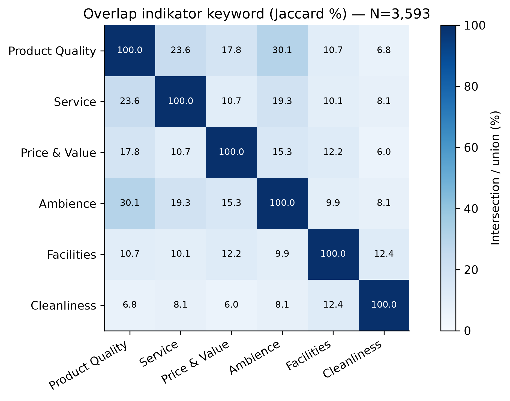
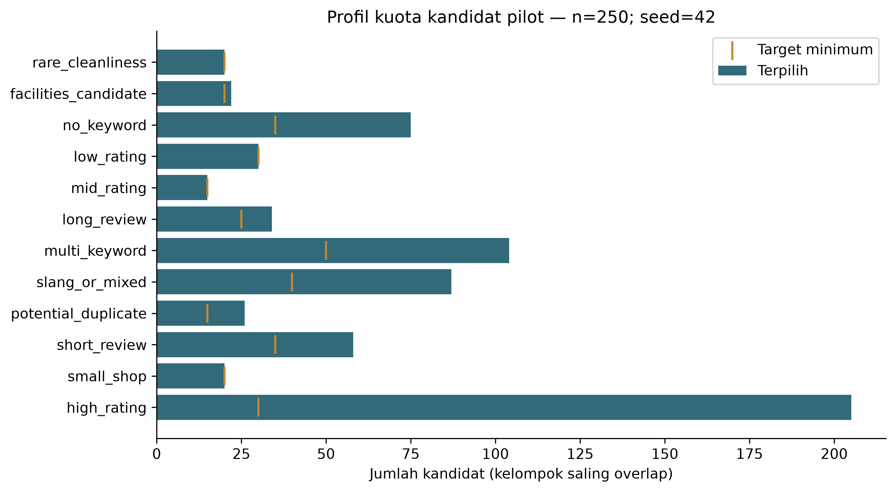

# Ringkasan Tahap 3 — Taksonomi dan pedoman anotasi

Versi: 0.1.0-draft. Status: draft berbasis literatur; belum empirically validated.

## Bukti literatur

7 referensi terverifikasi bibliografinya:
5 full text relevan dan
2 metadata/abstrak.
Sumber, DOI, lokasi bukti, dan batas akses ada di
[tinjauan literatur](../docs/research/aspect_taxonomy_literature_review.md),
[references.bib](../docs/research/references.bib), dan [matriks](tables/literature_matrix.csv).
Pemetaan researcher adaptation: [literature_aspect_mapping.csv](tables/literature_aspect_mapping.csv).

## Keputusan taksonomi

| ID | Aspek | Keputusan | Status |
| --- | --- | --- | --- |
| product_quality | Product Quality | ADAPT | aktif |
| service | Service | ADOPT | aktif |
| price_value | Price & Value | ADAPT | aktif |
| ambience | Ambience | ADAPT | aktif |
| facilities | Facilities | ADAPT | aktif |
| cleanliness | Cleanliness | ADAPT | aktif |
| location_accessibility | Location & Accessibility | PROVISIONAL | provisional |

Food/drinks/menu digabung Product Quality; waiting time masuk Service.
Miscellaneous/general praise tidak menjadi label semua aspek.
Facilities/Cleanliness dipisahkan berdasarkan objek+predikat, sebagai adaptasi penelitian.
Location & Accessibility didukung teori tetapi memerlukan validasi pilot dan scope.

## Bukti korpus yang diizinkan

| Indikator keyword Tahap 2 | Jumlah review |
| --- | --- |
| Product Quality | 1,452 |
| Service | 889 |
| Price & Value | 430 |
| Ambience | 1,343 |
| Facilities | 277 |
| Cleanliness | 175 |

Review tanpa keyword: 1,052; multi-keyword: 1,309.
Keyword bukan ground truth. Review tanpa keyword belum dinilai sebagai implicit atau out-of-taxonomy.
Overlap rinci ada pada [tabel](tables/stage3_keyword_overlap.csv).

## Pedoman dan schema

[Pedoman Indonesia](../docs/research/annotation_guidelines.md),
[keputusan metodologi/QA](../docs/research/stage3_methodology_decisions.md),
[YAML](../configs/aspect_taxonomy.yaml), dan [JSON Schema](../schemas/annotation_schema.json).

Task A multi-label presence; Task B tiga kelas pada aspek mentioned.
Neutral berbeda dari not_mentioned (sentiment=null); uncertain adalah status workflow.
Mixed mempertahankan evidence positif+negatif, pair sentiment=null dan tidak masuk
subset training tiga kelas. Contoh sintetis mendemonstrasikan konversi long format;
tidak ada dataset review asli berlabel yang dibuat.

## Kandidat pilot

250 kandidat unik dari 40 kedai; minimum
3 per kedai; seed=42. Universe eligible
3,582 review. Ranking SHA-256(seed|review_id)
dan kuota overlap-aware. CSV kandidat tidak memiliki teks atau label.
Rating/keyword metadata hanya untuk perancang sampling dan kelak disembunyikan dari annotator.

| Kelompok | Minimum | Terpilih | Shortfall |
| --- | --- | --- | --- |
| rare_cleanliness | 20 | 20 | 0 |
| facilities_candidate | 20 | 22 | 0 |
| no_keyword | 35 | 75 | 0 |
| low_rating | 30 | 30 | 0 |
| mid_rating | 15 | 15 | 0 |
| long_review | 25 | 34 | 0 |
| multi_keyword | 50 | 104 | 0 |
| slang_or_mixed | 40 | 87 | 0 |
| potential_duplicate | 15 | 26 | 0 |
| short_review | 35 | 58 | 0 |
| small_shop | 20 | 20 | 0 |
| high_rating | 30 | 205 | 0 |

Pilot kuota/oversampling tidak mencerminkan distribusi alami.
Bukti reproducibility: hasil identik setelah urutan input diacak.

## QA dan readiness

Rencana setelah izin: dua manusia independen, kalibrasi terpisah, penilaian
presence/sentimen sebelum adjudikasi, gold dan locked validation, lalu
perbandingan AI-manusia. Seluruh record dari review/kelompok duplikasi sama
dijaga dalam split sama. Tidak ada agreement atau performa model yang dihitung.

Geografi: {"UNVERIFIED": 40}.
Izin: PERMISSION_NOT_VERIFIED. Metodologi dapat direview tim; anotasi aktual tetap
menunggu gate geografis, hak penggunaan, privasi/duplikasi, dan protokol manusia.
Batas kategori overlap, implicit/mixed, coverage gap, dan aspek lokasi masih
memerlukan validasi pilot. Tidak ada klaim kesiapan rekomendasi bisnis/model.

## Pemeriksaan teknis

YAML, referensi sumber, JSON Schema, 31 record sintetis, aturan mixed,
neutral versus absence, multi-aspek, dan sampling reproducibility lulus pada notebook.
Hash raw tetap 7b87a53110041da74e976a6c9cb121c1dea7d73be70daeab58b2c07bef775719. Tidak ada raw/Tahap 2 yang diubah.
Kernel: BrewScope (.venv). Jalankan Restart Kernel and Run All pada
notebooks/02_aspect_taxonomy.ipynb; test otomatis menggunakan pytest.

Hash config: e73ae34262f300d5551ade75d732a1b99ba84799a034565da47778f9671ef2c8.
Hash schema: 44bbdb75cbdc2ef87c7f958ac0491c6088ea9f6ddbb5325196490055a0909648.
Hash kandidat: 6f292784a9f9fb38e52d040460a37909e56ebdade2e4eae6bddce74cc5ccf48f.
